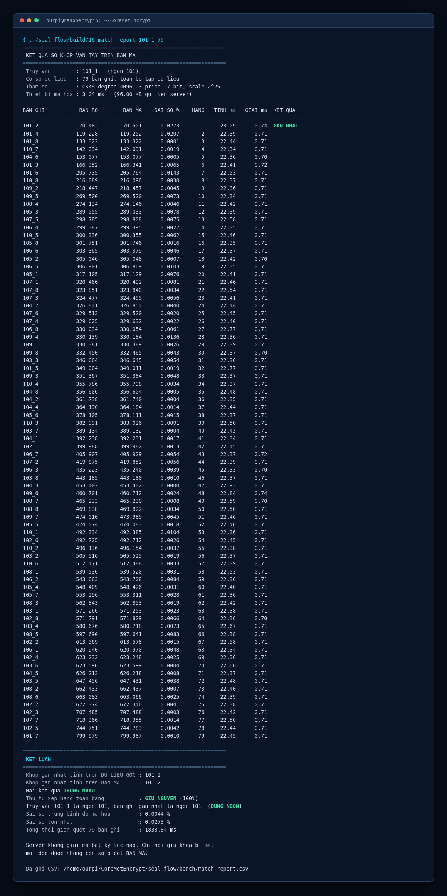

# Hệ thống bảo mật dữ liệu vân tay

Hệ thống so khớp vân tay thực hiện toàn bộ phép tính trên dữ liệu đã mã hoá. Máy
chủ xác định được khoảng cách giữa hai mẫu vân tay mà không giải mã ở bất kỳ bước
nào, do đó không tồn tại thời điểm nào dữ liệu sinh trắc nằm ở dạng đọc được trên
máy chủ.

Phần tính toán đồng cấu được xây dựng trên **Microsoft SEAL 4.4.4**, sử dụng lược
đồ **CKKS** cho số thực.



---

## Kết quả đo

Đo trong môi trường thử nghiệm, biên dịch ở chế độ Release.

| Chặng xử lý | Thời gian |
|---|---:|
| Mã hoá một mẫu vân tay | 3,15 ms |
| Truyền và nạp bản mã vào máy chủ | 0,13 ms |
| Tính khoảng cách trên bản mã | 22,51 ms |
| Giải mã kết quả | 0,72 ms |
| **Tổng một truy vấn, đầu đến cuối** | **26,51 ms** |

Kiểm chứng trên bộ dữ liệu chuẩn quốc tế FVC2004 DB3_B gồm 80 ảnh vân tay thật,
so khớp toàn bộ 3.160 cặp:

| Chỉ số | Giá trị |
|---|---:|
| Sai lệch tương đối trung bình giữa bản mã và dữ liệu gốc | 0,0091 % |
| Sai lệch tương đối lớn nhất | 0,23 % |
| Truy vấn cho kết quả gần nhất trùng với tính trên dữ liệu gốc | 100 % (80/80) |
| Tỉ lệ giữ đúng thứ tự xếp hạng, trên 246.480 cặp thứ tự | 99,99 % |
| Tỉ lệ quyết định khớp/không-khớp không đổi, quét 211 ngưỡng | 99,91 % |

Mười chín cặp bị đảo thứ tự đều là những cặp cách nhau dưới 0,028 đơn vị, trong khi
sai lệch tuyệt đối lớn nhất do mã hoá là 0,096. Nói cách khác, thứ tự chỉ đổi khi hai
bản ghi gần nhau tới mức chính sàn nhiễu không phân biệt nổi.

### Vì sao chọn bộ dữ liệu này

Bộ được chọn sau khi đo tỉ lệ nhận đúng hạng 1 của bộ trích đặc trưng trên toàn bộ
12 bộ ảnh công khai của FVC2000, FVC2002 và FVC2004 — tổng cộng 960 ảnh thuộc 120
ngón khác nhau. Bảng đo sinh bằng `tools/rank_survey.py`. FVC2004 DB3_B cho kết quả
cao nhất trong nhóm dùng cảm biến thật.

`demo.sh` chạy một lượt xác thực trên bộ này với 10 bản mẫu đã đăng ký; số liệu từng
bản ghi nằm ở `bench/workflow.csv`.

> **Phạm vi áp dụng.** Các chỉ số trên đánh giá *lớp mã hoá*, không phải độ chính
> xác nhận dạng. Độ chính xác nhận dạng phụ thuộc bộ trích đặc trưng, vốn là thành
> phần sẵn có của hệ thống tiếp nhận. Kết quả cho thấy lớp mã hoá không làm suy
> giảm kết quả của bộ trích đặc trưng được sử dụng.

---

## Nguyên lý

```
  Phía gửi                   Máy chủ                      Nơi giữ khoá
  ────────                   ───────                      ────────────
  vector đặc trưng
        │ mã hoá
        ▼
  ┌───────────┐  gửi đi   ┌────────────────────┐  kết quả  ┌──────────┐
  │  bản mã   │ ────────► │ trừ · bình phương  │ ────────► │ giải mã  │
  └───────────┘           │ cộng dồn 512 chiều │           └──────────┘
                          │   KHÔNG GIẢI MÃ    │
                          └────────────────────┘
```

CKKS cho phép thực hiện phép cộng, trừ và nhân trực tiếp trên dữ liệu đã mã hoá.
Máy chủ tính `d = q − e`, bình phương `d²`, sau đó cộng dồn 512 chiều thông qua 9
vòng xoay vector. Toàn bộ chuỗi phép tính diễn ra trên bản mã; chỉ bên nắm giữ
khoá bí mật mới giải được giá trị cuối cùng.

Tham số mã hoá: bậc đa thức 4096, ba prime 27-bit kèm một special prime 28-bit,
scale 2²⁵, đạt mức bảo mật 128-bit theo Homomorphic Encryption Security Standard.

---

## Dựng và chạy

Yêu cầu: Linux, CMake từ 3.13, trình biên dịch hỗ trợ C++17, Git, Python 3.

```bash
bash setup.sh
```

Script tải Microsoft SEAL 4.4.4 cùng các thành phần phụ thuộc từ upstream, áp dụng
các sửa đổi cần thiết, sinh bộ khoá và biên dịch toàn bộ chương trình.

Chạy thử toàn bộ một lượt xác thực:

```bash
bash demo.sh
```

Lệnh này chạy `17_workflow`, đi hết bốn chặng của hệ thống trong một lần gọi:
thiết bị đọc mẫu vân tay, mã hoá, máy chủ so khớp trên bản mã, rồi trả kết quả
về cho phía giữ khoá giải mã. Kết quả từng bản ghi được ghi ra
`bench/workflow.csv`.

Các phép đo riêng lẻ:

```bash
cd device && ../build/16_match_report 101_1 79   # bảng kết quả so khớp
cd device && ../build/15_bench_pipeline 30        # thời gian từng chặng xử lý
./build/14_fidelity                               # kiểm chứng trên 3.160 cặp
python3 tools/make_summary.py                     # tổng hợp số liệu
python3 tools/make_dashboard.py                   # dựng trang báo cáo
```

Hai chương trình đầu cần chạy từ thư mục `device/` vì bảng khoá được tham chiếu
theo đường dẫn tương đối.

---

## Thành phần

| Tệp nguồn | Chức năng |
|---|---|
| `src/10_fingerprint_encrypt.c` | Mã hoá mẫu vân tay phía gửi |
| `src/11_fingerprint_match.cpp` | Máy chủ tiếp nhận bản mã và tính khoảng cách Euclidean trên bản mã |
| `src/12_benchmark.cpp` | Đo thời gian từng phép toán đồng cấu phía máy chủ |
| `src/13_bench_device.c` | Đo thời gian mã hoá phía gửi |
| `src/14_fidelity.cpp` | Kiểm chứng độ trung thực trên toàn bộ 3.160 cặp của tập ảnh đưa vào |
| `src/15_bench_pipeline.cpp` | Đo tổng thời gian toàn luồng trong một tiến trình |
| `src/15_device_shim.c` | Lớp trung gian cho thư viện mã hoá phía gửi, vì header của thư viện này chỉ biên dịch được bằng trình biên dịch C |
| `src/16_match_report.cpp` | Sinh bảng kết quả một lượt nhận dạng và xuất CSV |
| `src/17_workflow.cpp` | Chạy trọn một lượt xác thực qua bốn chặng: đọc mẫu, mã hoá phía gửi, so khớp trên bản mã, giải mã kết quả |

| Công cụ | Chức năng |
|---|---|
| `tools/extract_features.py` | Trích vector đặc trưng 512 chiều từ ảnh vân tay theo phương pháp FingerCode |
| `tools/make_summary.py` | Tổng hợp các tệp CSV đo đạc thành một bảng thống kê |
| `tools/make_dashboard.py` | Dựng trang báo cáo HTML từ dữ liệu CSV |
| `tools/make_terminal_shot.py` | Thực thi chương trình, thu nhận kết quả và kết xuất thành ảnh |
| `tools/make_charts.py`, `make_chart_*.py` | Vẽ biểu đồ từ số liệu đo |
| `tools/npy_to_bin.py` | Chuyển vector đặc trưng sang định dạng nhị phân mà phần C/C++ đọc |
| `tools/encrypt_set.sh` | Mã hoá hàng loạt một tập vector bằng thư viện phía gửi |
| `tools/rank_survey.py` | Đo tỉ lệ nhận đúng hạng 1 của bộ trích đặc trưng trên từng bộ ảnh |
| `tools/make_screencast.py` | Chạy thật một phiên dòng lệnh và kết xuất thành video |
| `tools/make_terminal_png.py` | Chạy thật một lệnh và kết xuất kết quả thành ảnh |

Phần mã hoá phía gửi sử dụng SEAL-Embedded, biến thể của Microsoft SEAL dành cho
thiết bị tài nguyên hạn chế. Mã nguồn của cả hai thư viện không nằm trong repo này;
`setup.sh` tải trực tiếp từ upstream. Chi tiết các sửa đổi được áp dụng: xem
[`doc/REPORT.md`](doc/REPORT.md).

---

## Tác giả

Ngô Hoàng Nhật Khang · Hồ Anh Tuấn
Computer Science Engineering, VNUK Institute for Research & Executive Education
